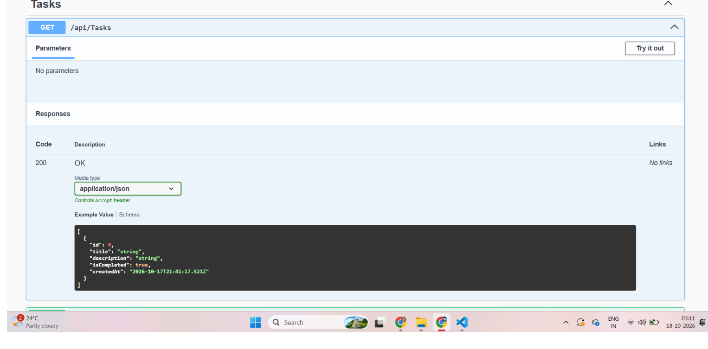

# Task Manager API

A RESTful Task Manager API built with **C#, ASP.NET Core and Entity Framework Core**. It supports full CRUD operations, input validation and DTOs, with interactive documentation through Swagger.

## Features

- Create, read, update and delete tasks (CRUD)
- Input validation with proper `400 Bad Request` responses
- DTOs to separate the API contract from the database model
- Entity Framework Core with SQLite and migrations
- Swagger UI for testing the API

## Tech Stack

- C# and .NET 10
- ASP.NET Core Web API
- Entity Framework Core (SQLite)
- Swagger (Swashbuckle)

## API Endpoints

| Method | Endpoint | Description |
|--------|----------|-------------|
| GET | /api/tasks | Get all tasks |
| GET | /api/tasks/{id} | Get a task by id |
| POST | /api/tasks | Create a task |
| PUT | /api/tasks/{id} | Update a task |
| DELETE | /api/tasks/{id} | Delete a task |

## How to Run

1. Clone the repository
   git clone https://github.com/Shru300/TaskManagerApi.git
   cd TaskManagerApi

2. Create the database
   dotnet ef database update

3. Run the app
   dotnet run

4. Open Swagger in your browser at http://localhost:5140/swagger
   (use the port shown in your terminal)

## Screenshots

## What I Learned

- Building REST APIs with ASP.NET Core controllers
- Database access with EF Core and migrations
- Model validation and the DTO pattern
- Using Git and GitHub
**Live demo:** https://taskmanagerapi-l6ag.onrender.com/swagger

> Note: hosted on a free tier, so the first load may take up to 60 seconds. Data resets when the server restarts.

## Author

Shruti - [GitHub](https://github.com/Shru300)
